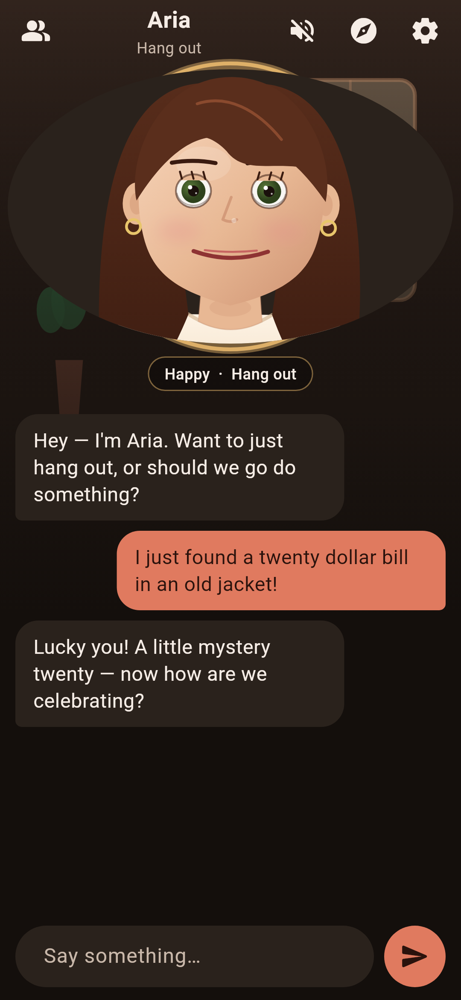
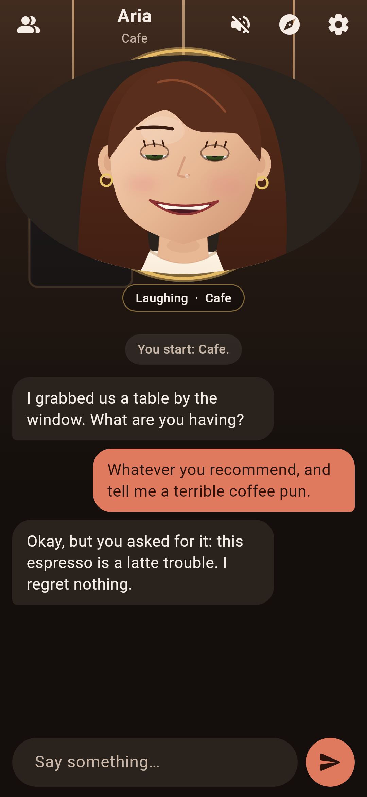
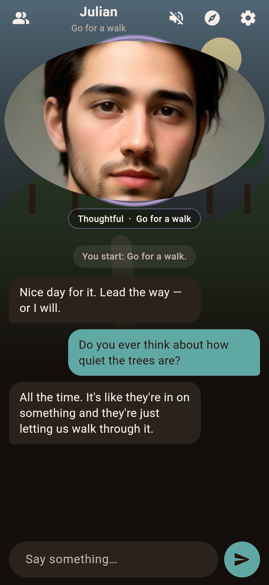
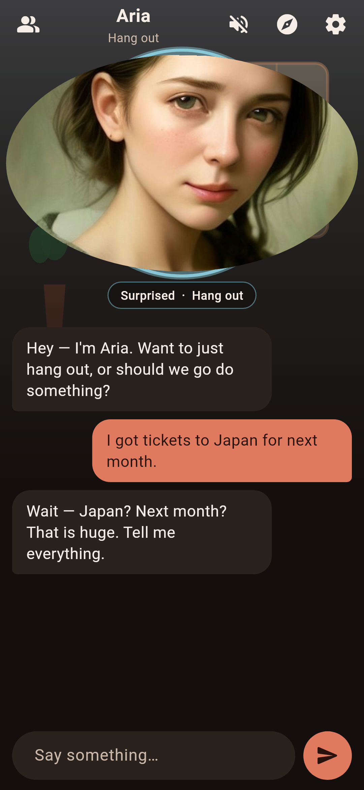

# Companion

An Android app where you chat with an AI character who **looks like a person** and **visually expresses emotion** while you talk. You can hang out, go for a walk, sit in a cafe, play 20 Questions or trivia, or make up a story together.

<p>
  
  
  
  
</p>

## Features

- **Two looks**, chosen when you start (and changeable in Settings):
  - **Cartoon** — a drawn, animated face (blinks, breathes, talks as the reply types out, and transitions between expressions).
  - **Semi-realistic** — painted portraits of the same person, crossfaded between expressions, with a blink and a little idle motion.
- **Two companions:** Aria (warm, curious, a little teasing) and Julian (calm, witty, a good listener). Each one works in both looks.
- **Ten expressions:** neutral, happy, laughing, sad, angry/annoyed, surprised, thoughtful, embarrassed, excited, worried. The model tags each reply with an emotion that drives the face.
- **Do things together:** hang out, go for a walk, cafe, 20 Questions, trivia, or a story adventure. The background changes with the scene, and they can suggest an activity too.
- **Memory:** the conversation is saved on your phone. Older turns are summarized so the character still remembers what you talked about.
- **Optional voice:** uses your phone’s built-in text-to-speech (off by default).
- Works without an API key. If you’re offline or the chat service is busy, you get a clear message and a Retry button.

## Install

Download `Companion-v1.0.apk` from the [latest release](../../releases/latest) and open it on your Android phone. You’ll need to allow “Install unknown apps” for your browser or file manager. Requires Android 7.0 or later.

Chat needs a network connection. The free text service allows about one reply every 30 seconds per device; if you send messages faster than that, the app will ask you to wait a moment.

## Build from source

Requires Flutter 3.35 or later.

```bash
flutter pub get
flutter test
flutter build apk --release
```

For release signing, create `android/key.properties` (it is gitignored) with `storeFile`, `storePassword`, `keyAlias` and `keyPassword`. Without that file, release builds fall back to the debug key.

Base semi-realistic portraits can be generated with `python3 tool/gen_portraits.py` (Pollinations Classic, no key, one image every 45 seconds). Expression variants of the same face are derived with `python3 tool/make_expressions.py`.

## Credits

Chat is provided by the free [Pollinations](https://pollinations.ai) text API (GPT-OSS 20B). Portrait images were generated with Pollinations’ Classic image API. Neither requires an API key; both are rate-limited and best-effort.
